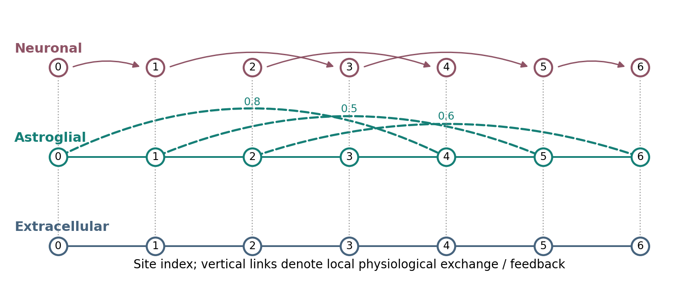
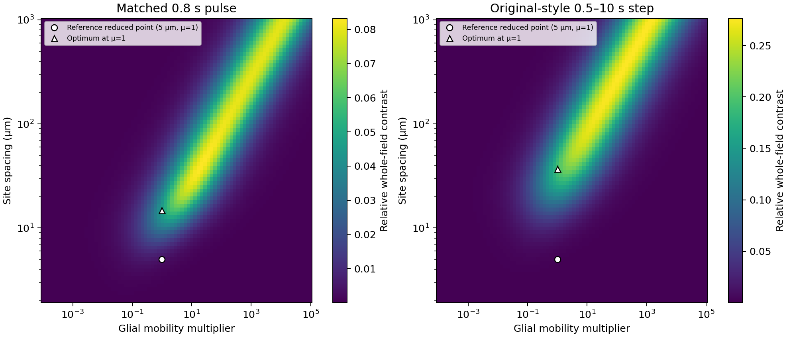

# The Syncytial Mesh Model (SMM)

**Identifying independent astroglial transport geometry in neuronal–ionic dynamics**

Andreu Ballús Santacana · Universitat Autònoma de Barcelona

SMM proposes that the spatial conditions governing neuronal activity can themselves possess a partially independent astroglial organization. It distinguishes neuronal connectivity, extracellular ionic transport and astroglial intercellular transport. The potassium-mediated realization (SMM-K) asks whether the third geometry makes a measurable contribution not reducible to the first two.

## Start here

| Resource | Contents |
|---|---|
| [Foundational manuscript](paper/manuscript.md) | Full version 3 text, equations, figures, references and supplements |
| [LaTeX source](paper/SMM_Final.tex) | Typeset manuscript source |
| [Interpretation and validation status](docs/VALIDATION.md) | Important geometric-scaling clarification, computational evidence and open empirical tests |
| [Reproducibility guide](reproducibility/README.md) | Parameters, scripts, numerical outputs and pinned source |
| [Historical implementation](docs/legacy/README.md) | Original coherence/resonome code and documentation, preserved for provenance |

## Central results

* Exact conditional recovery of a distinct glial transport operator from ideal full-field potassium transfer, without requiring commuting spatial operators.
* Graph-shape sensitivity vanishes at both glial mobility extremes. At nominal passive parameters, the synthetic geometrically scaled graph family has protocol-dependent intermediate sensitivity maxima.
* Exact recoverability does not imply practical identifiability. The inverse-conditioning analysis and nuisance-profiled information quantify the distinction.
* The strongest prospective test compares an independent glial graph with a flexible shared-support rival.
* Full conservative electrodiffusive benchmarks and a selective neuronal pump clamp constrain the physiological interpretation; the pump accounts for the neighboring voltage-sign reversal.

**Interpretation:** the spacing parameter in the passive sweep rescales the physical tissue graph, including its synthetic long edges. It is not an electrode-spacing optimization on a fixed tissue. These results are theoretical and computational, not a demonstration of topology-specific effects in living brain tissue.

## Research lineage and citation

The foundational manuscript develops the hypothesis in Ballús Santacana (2026), [Glial syncytial control fields and the low-frequency resonome of the human brain](https://doi.org/10.3389/fnhum.2026.1896291). The current manuscript is a research version, not represented here as an accepted publication. Cite the specific repository commit and [CITATION.cff](CITATION.cff) when using this material.

The original repository code and experimental history remain intact. The existing [MIT license](LICENSE) covers repository code; independently published source and third-party materials retain their own terms.
